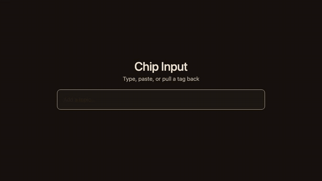

# Chip Input

[](LICENSE)

A tag field where typed words become paper tags. Paste splits on commas and newlines, Backspace on an empty field pulls the last tag back so you can edit it.



Plain HTML, CSS and JS. Zero dependencies. No image files: the tags are drawn in CSS. JS is about 4 KB gzipped.

## Install

```sh
npm install chip-input
```

or copy `dist/` into your project.

```html
<link rel="stylesheet" href="dist/chip-input.css">
<div id="topics"></div>
<script type="module">
  import { ChipInput } from './dist/chip-input.js';
  new ChipInput(document.getElementById('topics'), {
    label: 'Topics',
    name: 'topics',
    values: ['design'],
    max: 10,
    suggestions: ['design', 'research', 'motion'],
    onChange: (values, { type }) => console.log(type, values)
  });
</script>
```

A UMD build (`dist/chip-input.umd.cjs`) exposes the global `ChipInput.ChipInput`.

## Options

`new ChipInput(el, options)`

| Option | Default | Description |
|---|---|---|
| `values` | `[]` | Starting tags (trimmed, duplicates and blanks dropped) |
| `max` | none | Maximum number of tags. Extra items are skipped and announced |
| `validate(value, values)` | none | Return `false` or an error string to reject; `true` or nothing to accept |
| `suggestions` | none | Array of strings. Turns the field into a combobox with a listbox |
| `onChange(values, { type, changed })` | none | `type` is `add`, `remove`, `reorder` or `set` |
| `name` | none | Mirror the tags into hidden inputs with this name so a native `<form>` submits them |
| `allowDuplicates` | `false` | Duplicates are matched ignoring case and extra spaces |
| `delimiters` | `[',']` | Characters that commit a tag (Enter always does) |
| `label` | `Tags` | Accessible name of the field |
| `placeholder` | `Add a tag…` | Shown while there are no tags |

| Member | Description |
|---|---|
| `values` | Copy of the current tags (read only) |
| `add(value or array)` | Add tags; returns `{ values, added, skipped, errors }` |
| `remove(value)` | Remove a tag; returns `true` if it existed |
| `clear()` | Remove every tag |
| `setValues(array, silent?)` | Replace all tags. `silent: true` skips `onChange` |
| `focus()` | Focus the text field |
| `destroy()` | Remove the DOM, listeners and timers |

## Keyboard

| Key | Where | Does |
|---|---|---|
| Enter, comma | Field | Commit the text as a tag. Never while an IME is composing |
| Enter on an empty field | Field | Submits the surrounding form as usual |
| Backspace | Empty field | Pull the last tag back into the field to edit it |
| ArrowLeft | Empty field | Move to the last tag |
| ArrowLeft, ArrowRight, Home, End | Tag | Walk the tags; End and the last ArrowRight return to the field |
| Delete, Backspace | Tag | Remove it and move on |
| Alt+ArrowLeft, Alt+ArrowRight | Tag | Reorder |
| ArrowDown, ArrowUp, Enter, Escape | Field with suggestions | Open and move through suggestions, pick, close |

Paste splits on commas and newlines. Space always types a space, so multi-word tags work.

## Theming

Set these on the `.chip-input` element or any ancestor:

| Variable | Effect |
|---|---|
| `--ci-bg` | Field background |
| `--ci-line` | Field border |
| `--ci-text` | Text colour |
| `--ci-tag` | Tag fill |
| `--ci-edge` | Tag outline and hole |
| `--ci-tag-text` | Tag text |
| `--ci-accent` | Focus ring (default `#378add`) |

Colours follow `prefers-color-scheme`. Force a theme with `data-theme="light"` or `data-theme="dark"` on the element or any ancestor. When `max` is nearly reached the field border takes the tag outline colour (`.is-nearly-full`); at the limit it gets `.is-full`.

## Accessibility

- Focus stays on the text field. With `suggestions` it is a `combobox` using `aria-activedescendant`; without them it is a plain text field.
- Each tag has its own remove `<button>` named "Remove …". The buttons are focusable but not in the Tab order; use Delete on a focused tag, or a screen reader's virtual cursor.
- A polite live region announces adds, removals, duplicates, limits and reorders.
- Rejected input sets `aria-invalid` until the next keystroke.
- IME composition is respected, including Safari's out-of-order confirming Enter.
- Some Android keyboards send no useful keydown for comma or Enter; the field also commits when the text changes to include a delimiter.
- `prefers-reduced-motion` replaces the swing and flutter with a brief glow.

## Browser support

Current Chrome, Edge, Firefox and Safari.

## Licence

MIT. See `LICENSE`.
